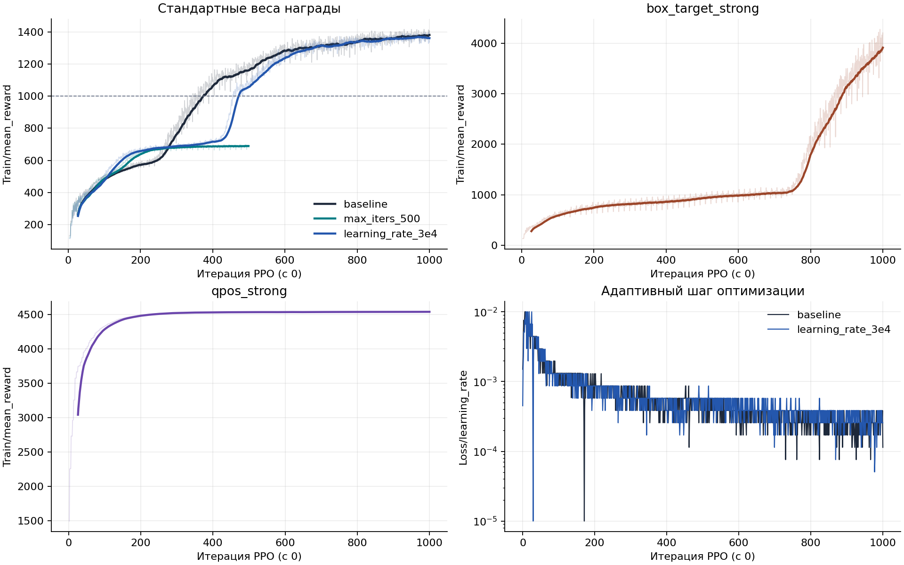

# Практика №2. Настройка PPO для PandaPickCube

## Условия

Взяли готовый baseline `report_ppo_gpu` и обучили четыре политики с нуля. В каждом опыте меняли один параметр.

## Сравнение (урок 6)

mean_reward - разница с baseline. При изменении весов меняется шкала награды, поэтому качество переноса сравниваем по SR.

| Урок | Запуск | Изменение | Финальный `mean_reward` | SR (mean_reward) | Время, с mean_reward |
|---|---|---|---:|---:|---:|
| 3 | `baseline` | Стандартная награда, 1001 итерация | 1396,26 | 10/10 | 1003 |
| 4, вариант Б | `max_iters_500` | `max_iters` 1001 -> 500 | 687,51 (−708,75) | 0/10 (−100) | 535 (−468) |
| 5, опыт A | `box_target_strong` | `box_target` 8.0 -> 40.0 | 4208,46 (+2812,20) | 9/10 (−10) | 1011 (+8) |
| 5, опыт B | `qpos_strong` | `robot_target_qpos` 0.3 -> 30.0 | 4537,20 (+3140,94) | 0/10 (−100) | 856 (−147) |
| 7 | `learning_rate_3e4` | Начальный `learning_rate` 0.001 -> 0.0003 | 1345,12 (−51,15) | 9/10 (−10) | 931 (−72) |

## Артефакты

| Запуск | Финальная модель | Конфиги и логи | Команды и метрики | Видео |
|---|---|---|---|---|
| `baseline` | [Чекпоинт](baseline/model_final.pt) | [Baseline и TensorBoard](baseline/) | [CSV обучения](baseline/training_metrics.csv) / [Эпизоды](baseline/video_final.json) | [MP4](baseline/video_final.mp4) |
| `max_iters_500` | [Чекпоинт](logs/max_iters_500/model_499.pt) | [Логи и TensorBoard](logs/max_iters_500/) | [Команды](results/max_iters_500/commands.sh) / [Эпизоды](results/max_iters_500/video.json) | [MP4](results/max_iters_500/video.mp4) |
| `box_target_strong` | [Чекпоинт](logs/box_target_strong/model_1000.pt) | [Логи и TensorBoard](logs/box_target_strong/) | [Команды](results/box_target_strong/commands.sh) / [Эпизоды](results/box_target_strong/video.json) | [MP4](results/box_target_strong/video.mp4) |
| `qpos_strong` | [Чекпоинт](logs/qpos_strong/model_1000.pt) | [Логи и TensorBoard](logs/qpos_strong/) | [Команды](results/qpos_strong/commands.sh) / [Эпизоды](results/qpos_strong/video.json) | [MP4](results/qpos_strong/video.mp4) |
| `learning_rate_3e4` | [Чекпоинт](logs/learning_rate_3e4/model_1000.pt) | [Логи и TensorBoard](logs/learning_rate_3e4/) | [Команды](results/learning_rate_3e4/commands.sh) / [Эпизоды](results/learning_rate_3e4/video.json) | [MP4](results/learning_rate_3e4/video.mp4) |
